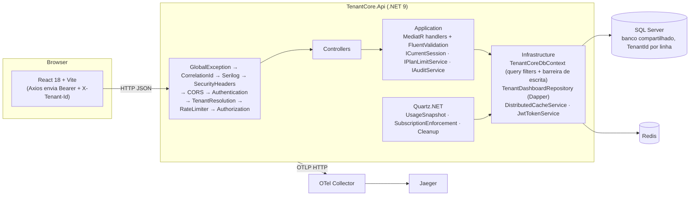

# tenant_core

SaaS B2B multi-tenant (monorepo) com API .NET 9 e painel React. Vários tenants (empresas)
compartilham o mesmo backend e o mesmo banco SQL Server; cada tenant tem seus usuários,
projetos, tarefas, clientes, assinatura/plano, snapshots de uso e trilha de auditoria.
O isolamento entre tenants é aplicado pela aplicação (middleware, sessão, query filters do EF Core
e barreira de escrita no `SaveChanges`). Detalhes em [docs/tenant-isolation.md](docs/tenant-isolation.md).

## O que o código faz

- Autenticação JWT (`sub`, `email`, `role`, `tenantId`, `jti`) com refresh token em cookie
  `HttpOnly`, armazenado como hash SHA-256, rotacionado no refresh e revogado no logout.
- RBAC com três papéis (`Admin`, `Manager`, `User`) e policies `TenantMember`, `ManagerOrAdmin`,
  `AdminOnly`.
- CRUD de projetos, tarefas e clientes; gestão de usuários e papéis; configurações do tenant.
- Limites por plano (`Free`, `Pro`, `Business`) aplicados no backend (`IPlanLimitService`).
- Auditoria das mutações sensíveis (`IAuditService`) e consulta paginada dos logs.
- Dashboard de projetos via Dapper (SQL bruto filtrado por `TenantId`).
- Cache Redis de resumos por tenant (`usage:{tenantId}`, `subscription:{tenantId}`).
- Jobs Quartz.NET in-process: snapshot de uso, estado de cota e limpeza.
- Observabilidade: Serilog (JSON), OpenTelemetry (traces/métricas via OTLP), correlation id,
  health checks `/health/live` e `/health/ready`.
- Rate limiting: 5 req/min por IP em `/api/auth/*`; 120 req/min por usuário no resto da API.

## Arquitetura



Camadas do backend (`backend/src`): `TenantCore.Domain` (entidades, enums, `TenantOwnedEntity`),
`TenantCore.Application` (CQRS com MediatR), `TenantCore.Infrastructure` (EF Core, Dapper, Redis,
Quartz, JWT, migrations, seed) e `TenantCore.Api` (controllers, middlewares, `Program.cs`).

## Como rodar

### Docker Compose (stack completa)

```bash
cp .env.example .env        # opcional: o compose tem valores padrão de desenvolvimento
docker compose up --build -d
```

| Serviço | URL |
| --- | --- |
| Frontend | http://localhost:5173 |
| API / Swagger (ambiente Development) | http://localhost:5000/swagger |
| Readiness | http://localhost:5000/health/ready |
| Jaeger | http://localhost:16686 |

Na subida, a API aplica as migrations e semeia dados de demonstração.

### Local (sem compose para a API)

Pré-requisitos: .NET SDK 9, Node 22, SQL Server e Redis acessíveis (por exemplo,
`docker compose up -d sqlserver redis`).

```bash
cd backend
dotnet restore tenant_core.sln
dotnet run --project src/TenantCore.Api      # usa appsettings.Development.json

cd ../frontend
npm ci
npm run dev
```

### Contas de demonstração (seed)

Senha de todas: `Passw0rd!`

| Tenant | Tenant ID | Contas |
| --- | --- | --- |
| Acme Operations | `11111111-1111-1111-1111-111111111111` | `admin@acme.test` (Admin), `manager@acme.test` (Manager), `user@acme.test` (User) |
| Globex Advisory | `22222222-2222-2222-2222-222222222222` | `admin@globex.test` (Admin) |

## Variáveis de ambiente

Configuração .NET usa `__` como separador de seção (`Jwt__SigningKey` = `Jwt:SigningKey`).

| Variável | Onde | Obrigatória | Descrição |
| --- | --- | --- | --- |
| `ConnectionStrings__SqlServer` | API | sim | Connection string do SQL Server. |
| `ConnectionStrings__Redis` | API | sim | Endpoint do Redis (`host:porta`). |
| `Jwt__SigningKey` | API | sim | Chave HMAC do JWT, mínimo 32 caracteres (a API não sobe sem ela). |
| `Jwt__Issuer` / `Jwt__Audience` | API | não | Padrão `tenant_core` / `tenant_core.web`. |
| `Jwt__AccessTokenMinutes` / `Jwt__RefreshTokenDays` | API | não | Padrão 15 min / 14 dias. |
| `Cors__AllowedOrigins__0` | API | não | Origem permitida (padrão `http://localhost:5173`). |
| `OpenTelemetry__OtlpEndpoint` | API | não | Endpoint OTLP HTTP; vazio desliga a exportação. |
| `Jobs__UsageSnapshotCron`, `Jobs__SubscriptionEnforcementCron`, `Jobs__CleanupCron` | API | não | Cron Quartz dos jobs. |
| `ASPNETCORE_ENVIRONMENT` | API | não | `Development` habilita Swagger. |
| `MSSQL_SA_PASSWORD` | compose | não | Senha do `sa` do container SQL Server (valor de desenvolvimento no `.env.example`). |
| `JWT_SIGNING_KEY` | compose | não | Repassada para `Jwt__SigningKey` da API. |
| `VITE_API_URL` | frontend (build) | não | URL base da API, sem barra final (padrão `http://localhost:5000`). |

Os valores em `.env.example` e `appsettings*.json` são apenas para desenvolvimento local.
Em qualquer ambiente exposto, defina senha e chave JWT próprias.

## Como testar

```bash
cd backend
dotnet test tenant_core.sln -c Release                                    # tudo
dotnet test tenant_core.sln -c Release --filter "Category!=SqlServer"      # sem Docker
dotnet test tenant_core.sln -c Release --filter "Category=SqlServer"       # só SQL Server real

cd ../frontend
npm run lint && npm test && npm run build
```

- `TenantCore.UnitTests`: JWT, limites de plano, guards de papel, paginação, middlewares,
  `HttpCurrentSession`, query filters e barreira de escrita.
- `TenantCore.IntegrationTests`: API em processo (EF InMemory) para fluxos de auth, isolamento
  entre tenants (`CrossTenantAccessTests`), limites de plano e auditoria; e a suíte
  `SqlServer/` com Testcontainers (SQL Server 2022 real, migrations aplicadas), que exige Docker.

O CI (`.github/workflows/ci.yml`) roda build e todos os testes do backend e lint/testes/build do
frontend em `pull_request` e em `push` para `master`.

## Deploy

`deploy-backend.yml` (imagem no GHCR + Azure App Service) e `deploy-frontend.yml`
(Azure Static Web Apps) rodam apenas em `push` para `master` ou manualmente
(`workflow_dispatch`), nunca em pull request. Dependem de secrets/vars configurados no
repositório. O estado de um ambiente publicado não foi verificado nesta revisão.

## Limitações e o que não está implementado

- Isolamento só na aplicação: não há Row-Level Security no SQL Server.
- A barreira de escrita não detecta FK cruzado (id de outro tenant numa entidade do tenant
  correto); os handlers validam essas referências. O FK `Tasks.ProjectId` tem cascade delete.
- Tenant é resolvido por header + claim; não há resolução por subdomínio.
- Não há cadastro self-service de tenants nem troca de tenant para o mesmo usuário.
- Mudança de plano é simulada (sem gateway de pagamento).
- Jobs Quartz usam store em memória: com várias instâncias da API, cada uma executa os jobs.
- A invalidação de cache acontece antes do `SaveChanges`; uma leitura concorrente pode
  repopular um valor antigo até o TTL (2–5 min).
- `ForwardedHeaders` confia em qualquer proxy (`KnownNetworks`/`KnownProxies` limpos), pensado
  para Azure App Service; fora dele, o IP usado no rate limit de auth pode ser forjado via
  `X-Forwarded-For`.
- A maioria dos testes de integração usa EF InMemory, que não aplica FKs nem tradução T-SQL;
  a suíte `SqlServer/` cobre os pontos de isolamento que dependem do banco real.

## Documentação

- [Arquitetura](docs/architecture.md)
- [Isolamento entre tenants](docs/tenant-isolation.md)
- [Segurança](docs/security.md)
- [Runbook](docs/runbook.md)
- ADRs: [0001 multi-tenancy](docs/adr/0001-multi-tenancy-banco-compartilhado.md),
  [0002 cache](docs/adr/0002-cache-redis-por-tenant.md),
  [0003 jobs](docs/adr/0003-jobs-quartz-in-process.md),
  [0004 barreira de escrita](docs/adr/0004-barreira-de-escrita-e-tenant-pelo-claim.md)
